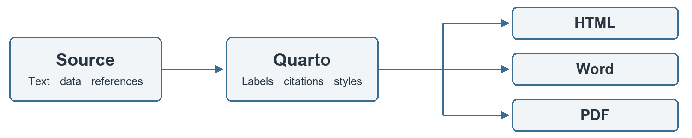
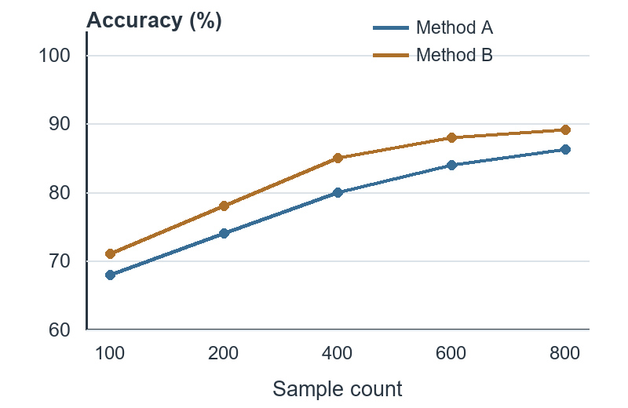
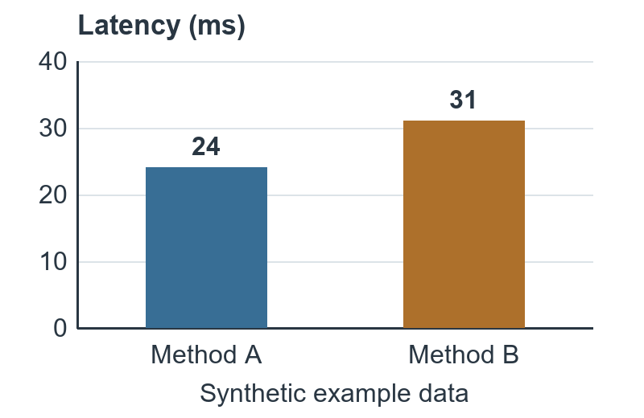

# Start writing {#sec-start}

Copy this file and replace the title, authors, language, date and bibliography in its YAML header. The project sets the citation style, HTML table of contents and section numbering. This document selects its HTML theme, Word reference document and PDF class. The Chinese counterpart, `template-zh.qmd`, covers the same features. Replace this explanatory body with your own text.

The four authors in the metadata demonstrate single, multiple and shared affiliations, optional ORCID, equal contribution and two corresponding authors. Match each author's affiliation `ref` to an institution `id`. Set `equal-contributor: true` for equal contribution, and `corresponding: true` with `email` for correspondence. Word generates numbers, † and envelopes and combines email addresses. HTML uses its native author block. PDF also displays affiliations, ORCID, equal contribution and correspondence, while inheriting the document class author font and date layout.

Run these commands from the project directory. All deliverables go into `output/`. Use the preview server for reliable HTML navigation and link behavior.

```bash
quarto render template-en.qmd --to docx
quarto render template-en.qmd --to pdf
quarto preview template-en.qmd --to html
```

Word uses a reference document stored in this repository. PDF uses Quarto's built-in LaTeX template with XeLaTeX and KOMA-Script's `scrartcl` class. The class controls fonts, headings and paragraphs. All four margins are 1 inch (25.4 mm) on A4 paper. The first PDF build requires a TeX distribution and the relevant packages. The examples contain static code, so rendering does not require Python or R.

## Headings and paragraphs {#sec-headings}

Put the document title in YAML `title`; start body headings at `#`, with `##` for the next level and no heading-level shift. Do not type section numbers into headings. Separate paragraphs with one blank line, and let the styles control indentation, spacing and pagination.

```markdown
# Method {#sec-method}
## Problem definition {#sec-problem}
# References {.unnumbered}
```

HTML includes a table of contents by default. For a Word or PDF report, set `toc: true` under the corresponding format to include one. The `.unnumbered` class keeps the references heading unnumbered while other sections retain their numbering.

# Citations and cross references {#sec-references}

Sections can also be referenced: see @sec-headings for heading syntax and @sec-math for equations. Quarto generates section, figure, table and equation numbers and references. Edit the source and render again to update them; pressing F9 in Word does not recalculate section numbers.

Literate programming connects explanations with implementation [@knuth1984]. A citation group uses one pair of brackets [@knuth1984; @shannon1948]. This group demonstrates syntax; it does not present these papers as comparable experiments. In English, retain ordinary word spacing around citations and cross references. In Chinese prose, do not insert spaces merely to separate a citation from adjacent characters.

```markdown
Literate programming connects explanation and code [@knuth1984].
The workflow is shown in @fig-workflow.
See @tbl-results and @eq-objective.
See @sec-headings and @sec-math.
```

Use citation keys from the local BibTeX file and preserve verified bibliographic metadata. A reference manager should own the research bibliography. Avoid literal references such as “Figure 1” or “[1]” in prose: numbering changes as a document grows. Use stable semantic labels, such as `fig-workflow`, `tbl-results` and `eq-objective`.

# Figures and tables {#sec-visuals}

## Individual figures and panels

@fig-workflow summarizes the document workflow. A caption should identify the objects and relationships needed to understand a figure. Alternative text provides a concise description for readers who use assistive technology.

{#fig-workflow width=100% fig-alt="A source document passes through Quarto to produce HTML, Word and PDF."}

```markdown
{#fig-workflow
  width=100% fig-alt="A concise description of the image"}
```

Panels can be cited separately: @fig-accuracy illustrates a trend and @fig-latency compares two values. Use @fig-comparison to refer to the complete group. Arrange images in columns when side-by-side comparison serves the argument.

::: {#fig-comparison layout-ncol=2}
{#fig-accuracy fig-alt="Two synthetic accuracy curves rise as sample size increases."}

{#fig-latency fig-alt="Synthetic latencies of 24 and 31 milliseconds for methods A and B."}

Two views of synthetic data. The left panel demonstrates a trend; the right compares individual values. These are layout examples, not experimental findings.
:::

## Table captions and notes

@tbl-results demonstrates left-aligned labels, right-aligned numeric columns and a separate explanatory note. Put units in the column headers. Keep qualifications in a table note when they do not belong in the caption or an individual cell.

:::: {#tbl-results}
| Method | Accuracy (%) | Latency (ms) |
|:-------|-------------:|-------------:|
| Method A | 86.2 | 24 |
| Method B | 89.1 | 31 |
| Reference setting | 82.7 | 20 |

::: {.table-note custom-style="Table Note"}
Note: All values are synthetic. Higher accuracy and lower latency are preferable.
:::

A numerical comparison of the demonstration methods.
::::

Use native Markdown tables or a table tool that supports the target formats. Avoid replacing an entire table with a screenshot. Long tables, merged cells and journal-specific layouts need their own review.

# Mathematical notation {#sec-math}

Write inline variables as $x_i$, vectors as $\mathbf{x}$ and sets as $\mathcal{D}$. Use upright units with mathematical spacing, such as $24\,\mathrm{ms}$. Give a numbered equation a semantic label:

$$
\mathcal{L}(\theta)=\frac{1}{N}\sum_{i=1}^{N}
\left(f_\theta(\mathbf{x}_i)-y_i\right)^2
+\lambda\lVert\theta\rVert_2^2.
$$ {#eq-objective}

In @eq-objective, the first term measures prediction error and the second penalizes parameter magnitude. Here $N$ is the sample count and $\lambda$ is a nonnegative weight. The equation illustrates notation and symbol definitions.

Break long equations according to their structure and the available text width. When moving from two columns to one, remove inherited line breaks that are no longer useful. An `aligned` environment is suitable for a sequence of related expressions:

$$
\begin{aligned}
\widehat{y}_i &= f_\theta(\mathbf{x}_i), \\
r_i &= \widehat{y}_i-y_i, \\
\operatorname{MSE} &= \frac{1}{N}\sum_{i=1}^{N}r_i^2.
\end{aligned}
$$ {#eq-residuals}

# Other useful elements {#sec-elements}

Use lists for parallel items or ordered steps. Let the renderer generate the displayed list numbers:

1. Define the research question and symbols.
1. Present the method, evidence and limitations.
1. Check consistency between claims, citations and results.

> A block quotation separates a short passage from the surrounding text. This sentence was written for the template; it is not a quotation from an external source.

Use footnotes for brief supporting details.[^example-note] A link can point to the [Quarto documentation](https://quarto.org/docs/guide/). Inline code looks like `quarto render`. A fenced code block can show an example without executing it:

[^example-note]: A footnote should not contain information essential to understanding the main argument.

```python
def mean(values):
    """A static example; this block is not executed."""
    return sum(values) / len(values)
```

::: {.callout-note appearance="simple"}
## Usage note

Use callouts sparingly in a research manuscript. This example demonstrates their behavior across output formats.
:::

# Maintenance and reproducibility {#sec-maintenance}

The Word templates, CSL style and author extension are stored with the project. Before an update, commit the current project, explicitly replace a style or install a chosen extension version, and inspect all three formats in both languages. Sources and file checksums are recorded in `styles/manifest.json`. A new project retains its copied files when the remote template changes.

Local snapshots make style inputs traceable. Pagination also depends on Quarto, Pandoc, TeX, fonts and Word versions. Archive the source, tool versions and final PDF for a completed document. Stronger reproduction requires those tools and fonts to be pinned as well.

# References {.unnumbered}

::: {#refs}
:::
