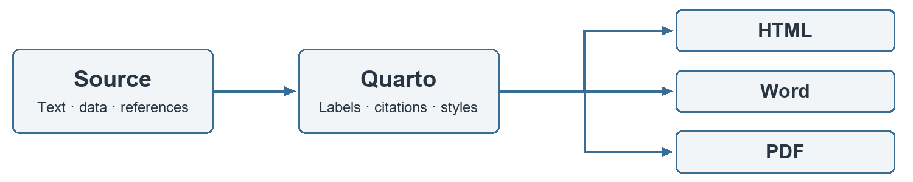
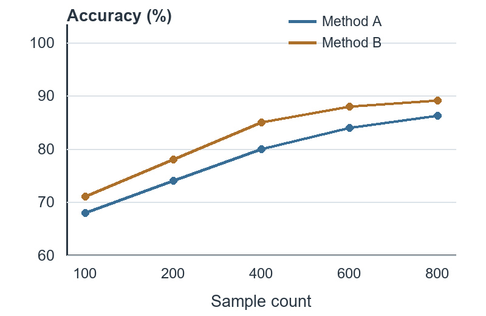
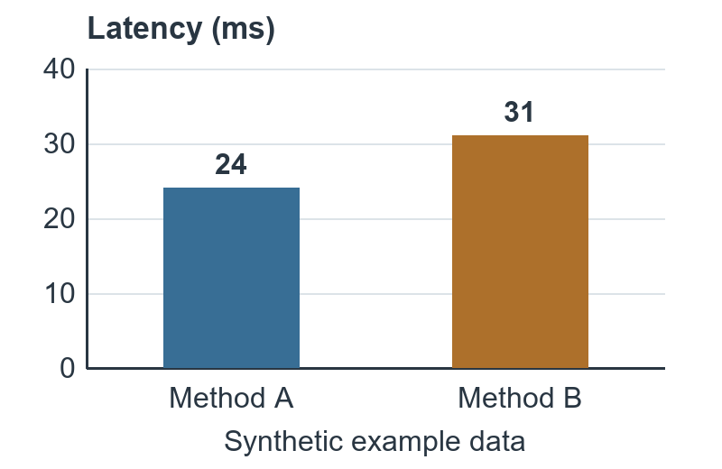

# 开始写作 {#sec-start}

复制本文件并修改 YAML 中的标题、作者、语言、日期和文献路径，即可开始写作。公共样式位于项目配置中；单篇文档明确选择参考文献样式、目录和编号。英文项目使用 `template-en.qmd`，两份文件演示相同功能。正文可直接替换，不必保留这份说明。

元数据中的四位示例作者演示了单机构与多机构、共享机构、有无 ORCID、同等贡献和两位通信作者。使用 `affiliations` 中的 `id` 与作者的 `ref` 关联机构；`equal-contributor: true` 表示同等贡献，`corresponding: true` 配合 `email` 指定通信作者。Word 自动生成数字、† 和信封，并合并邮箱。HTML 使用原生作者区；PDF 作者区同样显示机构、ORCID、同等贡献和通信邮箱，字体与日期排版继承文档类。

在项目目录运行以下命令。生成文件统一放入 `output/`；HTML 通过预览服务器阅读时，目录导航和链接行为最稳定。

```bash
quarto render template-zh.qmd --to docx
quarto render template-zh.qmd --to pdf
quarto preview template-zh.qmd --to html
```

Word 使用仓库内的 reference-doc。PDF 使用 Quarto 内置模板、XeLaTeX 和 `ctexart`，四边页边距设为 1 英寸（25.4 mm），标题、字体及段落遵循文档类的排版规则。首次生成 PDF 需要安装 TeX 环境及相应宏包。中文字体由 CTeX 根据运行环境自动选择；不同系统的字体和分页可能不同。

## 标题与段落 {#sec-headings}

文档总标题写在 YAML 的 `title` 中；正文从 `#` 开始，`##` 表示下一层级，不设置标题层级偏移。标题中不写“1”“1.1”等手工编号。段落之间留一个空行，不用空格、制表符或连续空行控制缩进与版面。Word 的正文缩进、行距和标题间距由样式负责。

```markdown
# 方法 {#sec-method}
## 问题定义 {#sec-problem}
# 参考文献 {.unnumbered}
```

若报告需要目录，可在本文件中设置 `toc: true`。参考文献标题使用 `.unnumbered`，与是否开启其他章节编号无关。

# 引用与交叉引用 {#sec-references}

章节也可自动引用：标题写法见[@sec-headings]，公式规范见[@sec-math]。章节、图表和公式的编号与引用均由 Quarto 生成；修改源文件后重新渲染即可更新，Word 中的 F9 不会重新计算章节编号。

中文引用前后不硬编空格：文学化编程强调解释与实现的结合[@knuth1984]。多个文献使用同一个引用组，例如[@knuth1984; @shannon1948]。此处仅演示引用语法，不把两篇文献视作同一领域的比较实验。

```markdown
文学化编程强调解释与实现的结合[@knuth1984]。
方法流程如[@fig-workflow]所示。
结果见[@tbl-results]，目标函数见[@eq-objective]。
标题写法见[@sec-headings]，公式规范见[@sec-math]。
```

引用键来自本地 BibTeX 文件；文献条目应由文献管理器维护，保留真实的作者、题名和 DOI。不要直接写“见图 1”或“文献 [1]”，因为增加内容后编号可能变化。标签使用稳定的含义，如 `fig-workflow`、`tbl-results` 和 `eq-objective`，不用当前编号命名。

# 图片与表格 {#sec-visuals}

## 单图与分图

流程如[@fig-workflow]所示。图题应说明图中对象、符号和读者需要理解的关系；替代文本概括视觉信息，帮助使用屏幕阅读器的读者。

{#fig-workflow width=100% fig-alt="源文件经过 Quarto，分别输出 HTML、Word 和 PDF。"}

```markdown
{#fig-workflow
  width=100% fig-alt="供屏幕阅读器使用的图像描述"}
```

分图可以分别引用：[@fig-accuracy]展示演示曲线，[@fig-latency]展示演示时延。整组图片则使用[@fig-comparison]。多栏图片仅用于真正需要并列比较的内容。

::: {#fig-comparison layout-ncol=2}
{#fig-accuracy fig-alt="两条演示准确率曲线随样本量增加而上升。"}

{#fig-latency fig-alt="方法 A 和方法 B 的演示时延分别为 24 和 31 毫秒。"}

演示数据的两种视角。左图用于展示趋势，右图用于展示数值比较；这些数据仅用于检验排版。
:::

## 表题与表注

[@tbl-results]演示文本列左对齐、数值列右对齐，以及表题和表注的分工。单位放在表头；表注说明取值含义，不把表注硬塞进题注或单元格。

:::: {#tbl-results}
| 方法 | 准确率（%） | 时延（ms） |
|:-----|------------:|----------:|
| 方法 A | 86.2 | 24 |
| 方法 B | 89.1 | 31 |
| 参考设置 | 82.7 | 20 |

::: {.table-note custom-style="Table Note"}
注：所有数值均为合成示例。准确率越高越好；时延越低越好。
:::

演示方法的数值比较。
::::

表格使用原生 Markdown 或支持多格式的表格工具，避免把整张表截成图片。复杂跨页表格、合并单元格和期刊专用格式需要单独检查。

# 数学表达 {#sec-math}

行内变量写作 $x_i$，向量写作 $\mathbf{x}$，集合写作 $\mathcal{D}$。单位使用正体并留数学间距，例如 $24\,\mathrm{ms}$。编号公式使用稳定标签：

$$
\mathcal{L}(\theta)=\frac{1}{N}\sum_{i=1}^{N}
\left(f_\theta(\mathbf{x}_i)-y_i\right)^2
+\lambda\lVert\theta\rVert_2^2.
$$ {#eq-objective}

[@eq-objective]中的第一项衡量预测误差，第二项惩罚参数幅值。$N$ 为样本数，$\lambda$ 为非负权重。本公式只用于说明排版与符号定义。

长公式可以按结构和当前版心换行。由双栏稿迁移到单栏时，应去掉已经没有必要的手工换行；确实过长的推导可用 `aligned` 对齐。

$$
\begin{aligned}
\widehat{y}_i &= f_\theta(\mathbf{x}_i), \\
r_i &= \widehat{y}_i-y_i, \\
\operatorname{MSE} &= \frac{1}{N}\sum_{i=1}^{N}r_i^2.
\end{aligned}
$$ {#eq-residuals}

# 其他常用内容 {#sec-elements}

列表适合表达并列事项或有先后顺序的步骤。列表编号也交给渲染器生成：

1. 先说明研究问题与符号含义。
1. 再展示方法、证据和限制。
1. 最后核对引用、图表与结论是否一致。

> 引述块可以放置需要与正文区分的短段落。此句为模板自拟示例，不是外部文献的直接引文。

补充说明可以使用脚注。[^example-note] 链接写为[Quarto 文档](https://quarto.org/docs/guide/)。行内代码使用 `quarto render`；静态代码块只展示语法，不要求读者安装 Python 或 R。

[^example-note]: 脚注适合短补充，不应承载理解主要论证所必需的内容。

```python
def mean(values):
    """A static example; this block is not executed."""
    return sum(values) / len(values)
```

::: {.callout-note appearance="simple"}
## 使用提示

科研稿件中应节制使用提示框。本例展示 Quarto 的跨格式排版。
:::

# 维护与复现 {#sec-maintenance}

Word 模板、CSL 和作者扩展随项目保存。更新时先提交当前项目，再显式替换样式或安装指定版本的扩展，并重新检查中英文三种输出。样式来源和文件散列记录在 `styles/manifest.json` 中；新项目保留所复制的版本，不会因远端模板变化而自动改变。

本地样式快照保证样式文件可追溯，但排版仍受 Quarto、Pandoc、TeX、字体以及 Word 版本影响。正式归档时同时保存源文件、工具版本与最终 PDF；需要严格复现时，还应固定这些工具和字体的版本。

# 参考文献 {.unnumbered}

::: {#refs}
:::
